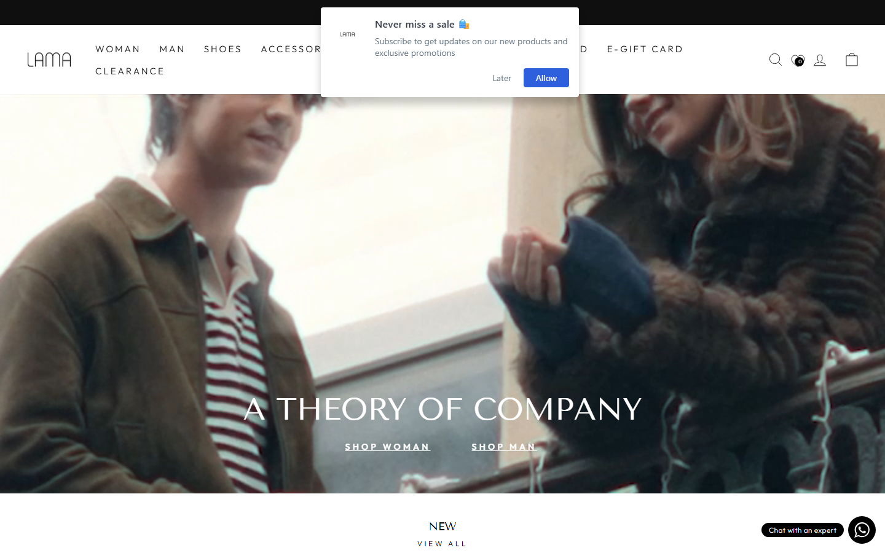

# LAMA Retail Replica (Assignment 2)

**Student:** FA24-BCS-068

A front-end e-commerce replica of the Lama Retail Pakistan store, with a **homepage** (`index.html`) and a **product detail page** (`product.html`). It's built with **HTML5, CSS3, Bootstrap 5 (CSS) and vanilla JavaScript (ES6+)**, with no build tools: open `index.html` in a browser and it runs.

> **Note:** Educational replica - brand assets belong to Lama Retail.

---

## 1. Reference Site

| | |
|---|---|
| **Name** | Lama Retail (LAMA) - Pakistan online store |
| **URL** | <https://pk.lamaretail.com/> |
| **Screenshot** | `screenshots/reference-site-lamaretail.png` (below) |



What was copied from the reference site:
- **Fonts:** Outfit (body, weight 300) and Tenor Sans (uppercase headings).
- **Sizes:** menu 15px with 3px letter-spacing, hero title 50px, logo 70x23.
- **Colours and layout:** the black announcement bar, white header and white footer.
- **Media:** the hero video, the category banners and the real product photos.

---

## 2. Deliverables

| Deliverable | File(s) |
|---|---|
| Homepage | `index.html` |
| Product detail page | `product.html` (any product: `product.html?id=prod-new-1`, `?id=prod-shoes-2`, ...) |
| CSS | `css/` - 9 stylesheets + Bootstrap 5.3.3 (CDN) |
| JavaScript | `js/` - 9 scripts |
| README with reference site | `README.md` (this file) + `screenshots/reference-site-lamaretail.png` |
| Screenshots at 3 widths | `screenshots/` - phone 375px, tablet 768px, desktop 1440px, for both pages |
| Completion PDF | `FA24-BCS-068_Assignment2_Completion.pdf` |

---

## 3. Where Bootstrap Is Used

Bootstrap 5.3.3 is loaded as a CSS file (no Bootstrap JavaScript). Our own CSS files are loaded after it, so they can restyle it.

| Part of the page | Bootstrap classes |
|---|---|
| Header / navbar | `navbar navbar-expand-lg`, `navbar-brand`, `navbar-nav`, `nav-item`, `nav-link`, `d-flex gap-1`, `badge rounded-pill text-bg-dark` (cart count) |
| Product rows (homepage) | Each row is a `row flex-nowrap row-cols-2 row-cols-md-3 row-cols-lg-4 row-cols-xl-5 g-3`, so 2 / 3 / 4 / 5 cards fit on screen and the rest scroll sideways |
| Product page layout | `row g-4` with `col-12 col-md-6` (photos and details stack on phones, side by side from 768px) |
| "You may also like" grid | `row row-cols-2 row-cols-md-4 g-3` |
| Footer | `row` / `col-12 col-md-6 col-lg-5` ..., store cities `row row-cols-1 row-cols-md-3` |
| Forms and buttons | `breadcrumb`, `btn btn-dark / btn-light / btn-outline-dark`, `btn-check` (size buttons), `input-group` (quantity, newsletter), `form-control`, `form-select` |

Brand colours, square corners and fonts are set through Bootstrap's own CSS variables in `css/base.css` (`--bs-body-font-family`, `--bs-border-radius: 0`, `--bs-btn-bg`, ...).

---

## 4. Responsive Screenshots

| Page | Phone (375px) | Tablet (768px) | Desktop (1440px) |
|---|---|---|---|
| Homepage | `screenshots/index-phone-375.png` | `screenshots/index-tablet-768.png` | `screenshots/index-desktop-1440.png` |
| Product page | `screenshots/product-phone-375.png` | `screenshots/product-tablet-768.png` | `screenshots/product-desktop-1440.png` |

---

## 5. Features

- **Header:**
  - Announcement bar with 2 rotating messages.
  - Sticky Bootstrap navbar.
  - Desktop mega menu built from data in `js/data.js`, with Woman / Man columns under Shoes and Accessories.
  - Phone slide-in menu with accordions.
  - Search overlay.
  - Cart icon with item count.
- **Homepage:**
  - Full-width hero video (muted, looping).
  - 5 product rows (New, Shoes, Jackets & Coats, Sweaters & Cardigans, Bags) with category banners. The banners use `<picture>`, so phones get portrait images.
- **Product cards:**
  - Real product photo, swapping to a second photo on hover.
  - Name (links to `product.html?id=...`), price and colour.
  - "+" button opening a size picker, which adds the item to the cart.
- **Product page:**
  - The product is chosen with `?id=` in the URL.
  - Breadcrumb.
  - Large photo with thumbnail buttons.
  - Name, price and BaadMay "3 installments" amount.
  - Size buttons (a size is required).
  - Quantity selector (- / +, from 1 to 10).
  - Add to Cart.
  - Description, Size & Fit and Shipping accordions (`<details>`).
  - "You may also like" grid.
- **Cart:**
  - Slide-in drawer with + / - / Remove.
  - Subtotal and BaadMay amount (subtotal / 3).
  - Saved in `localStorage`, so it survives a refresh.
- **Footer (same on both pages):**
  - Newsletter with email validation.
  - Links and currency selector.
  - Social icons.
  - Customer service, and store locations in Lahore / Islamabad / Karachi (accordions on phones).
- **Accessibility:**
  - Semantic tags and alt text.
  - `aria-label` / `aria-expanded`.
  - Keyboard support: Esc closes menus and drawers, and focus stays inside open drawers.
  - Visible focus rings.
  - Reduced-motion support.

---

## 6. Directory Structure

```text
assignment 2/
├── index.html                 # Homepage
├── product.html               # Product detail page
├── README.md
├── FA24-BCS-068_Assignment2_Completion.pdf
├── ANTIGRAVITY_BUILD_PLAN.md
├── css/
│   ├── base.css           # Tokens (:root), reset, Bootstrap overrides, buttons, typography
│   ├── header.css         # Announcement bar, navbar, mega menu, search overlay, phone drawer
│   ├── hero.css           # Hero video, title overlay & shop buttons (homepage)
│   ├── product-card.css   # Product cards, hover photo swap, size picker panel & toast
│   ├── sections.css       # Category banners & sideways-scrolling product rows
│   ├── product.css        # Product page: gallery, details, size / quantity, accordions
│   ├── cart.css           # Cart drawer, quantity steppers, subtotal & BaadMay block
│   ├── footer.css         # Footer, newsletter, currency, social, store locations
│   └── responsive.css     # Small-phone tweaks & print styles
├── js/
│   ├── data.js            # Menu data, 25 products, formatPrice, scroll-lock / focus-trap helpers
│   ├── menu.js            # Desktop mega menu, phone drawer, search overlay
│   ├── slider.js          # Reusable Slider class (announcement bar) + hero video reduced motion
│   ├── products.js        # Builds product cards and the homepage rows
│   ├── quick-add.js       # "+" size picker -> sends cart:add
│   ├── cart.js            # Cart drawer, localStorage, totals, BaadMay
│   ├── footer.js          # Newsletter validation, currency, footer accordions
│   ├── main.js            # Homepage: builds the 5 rows + fade-in on scroll
│   └── product-page.js    # Product page: shows ?id= product, gallery, size, quantity, Add to Cart
├── screenshots/           # Reference site + both pages at 375 / 768 / 1440px
└── assets/
    ├── banners/           # <category>-desktop.jpg (1920x750) + <category>-mobile.jpg (720x990)
    ├── videos/            # hero.mp4 - hero video from pk.lamaretail.com
    ├── products/          # <product>-<colour>-<n>.jpg, real product photos (540x810)
    ├── icons/             # BaadMay logo + checkout step icons (SVG)
    └── logo/              # logo.webp, logo.png (favicon), og-image.jpg (link preview)
```

---

## 7. How to Run

1. Open the `assignment 2` folder in File Explorer.
2. Double-click `index.html` (any modern browser: Chrome, Edge, Firefox, Safari).
3. Click any product name to open its page in `product.html`.

No server, Node.js or build step is needed. An internet connection is needed for Bootstrap and Google Fonts (both load from a CDN).
